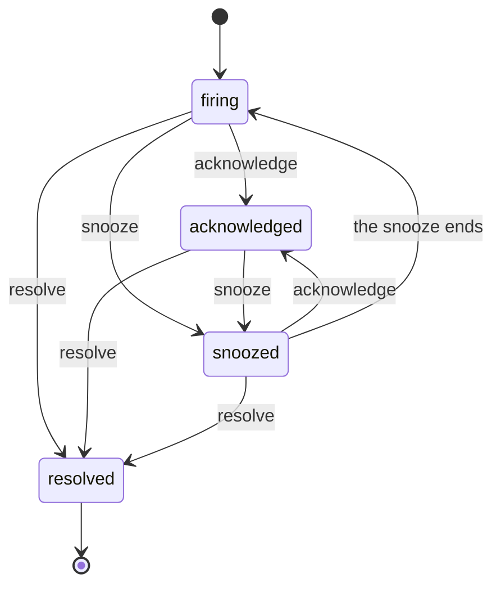

An alert is one problem reported by a source. This page describes the states it moves through and the timeline that records what happened to it. The tables are described in [[configuration-and-data-model]].

## States

| State | Meaning |
|---|---|
| `firing` | The problem is happening and nobody has taken it. Every new alert starts here. |
| `acknowledged` | Someone has taken responsibility for it. |
| `snoozed` | Someone asked not to be bothered until a given time. |
| `resolved` | The problem is over. This state is final. |

Only the moves in the diagram are allowed. Anything else is refused and changes nothing, including an action that would leave the alert where it is, such as acknowledging an acknowledged alert.

- **Snooze** needs an end time in the future. The snooze button in Slack snoozes for one hour. When it passes, Beacon returns the alert to `firing` by itself, within a few seconds.
- **Resolve** can come from a person or from the source. A resolved alert never changes again: if the source reports the same problem later, Beacon opens a new alert.
- While an alert is open, repeated deliveries of it from the source refresh its labels, annotations, links, severity and the time it was last received. They do not change its state.

## Deduplication and auto-resolve

Sources repeat themselves: Alertmanager and Grafana send a firing alert again on every repeat interval, senders retry a request that timed out, and a pair of Alertmanagers may both deliver the same notification. Beacon recognises an alert by its **source and fingerprint**. The fingerprint is the one the source sends, or is computed from the labels; see [[webhook#Identity]], [[alertmanager]] and [[grafana]].

| Delivery | The source has an open alert with the fingerprint | It has none |
|---|---|---|
| Firing | The alert is refreshed: labels, annotations, links, severity and the time it was last received. Its state stays, no event is written and nobody is notified. | A new alert is opened, `firing`. |
| Resolved | The alert is resolved, and a `resolved` event by the source is written. | Nothing happens, and the request still succeeds. |

- **One open alert per source and fingerprint, whatever arrives at once.** Deliveries of the same alert take turns, so of several that arrive together one opens the alert and the others refresh it; none fails. A unique index in the database refuses a second open alert outright, so the rule holds even against a fault in Beacon.
- **A resolved alert that fires again is a new alert**, with its own timeline. The resolved one is never reopened.
- **The time of the resolution** is the one the source gives, when it gives one and it is not in the future. The event on the timeline carries the time Beacon learned of it.
- **The same fingerprint from two sources** is two alerts. Point the members of an Alertmanager cluster at one source.
- **A resolution that never arrives** leaves the alert open. Beacon does not guess that a silent source means a solved problem. Resolve such an alert by hand.

## Groups

Every alert belongs to an alert group: the alerts that share the values of the `group_by` labels (see [[configuration#Grouping]]). An alert joins its group when it is opened and stays in it, even if a later delivery changes its labels.

A group is `open` while any of its alerts is not resolved, and `resolved` once all are. A resolved group never opens again: the next alert with the same labels opens a new group. Notifications are sent for the group ([[notifications#Groups]]), and an action taken on a group's message applies to each of its alerts that allows it.

## Silences

A silence keeps notifications about matching alerts back for a period; see [[silences]]. It is not a state: a silenced alert is `firing`, or whatever it would be otherwise, and can be acknowledged, snoozed and resolved like any alert.

## Severity

Every alert has one of three fixed levels: `critical`, `warning` or `info`. The level is read from a label of the alert, as the alert's source says; see [[configuration#Severity]].

## Routing

When an alert is opened, the routing rules decide its team, its service and the escalation policy of its group; see [[configuration#How an alert is routed]]. The alert keeps what was decided for as long as it is open.

## Timeline

Every state change is recorded as an event on the alert's timeline, in the same database transaction as the change. An event is never edited or removed.

| Event | Written when |
|---|---|
| `fired` | The alert is opened |
| `acknowledged` | Someone acknowledges it |
| `snoozed` | Someone snoozes it; the event holds the end time |
| `snooze_ended` | The snooze runs out and the alert fires again |
| `resolved` | A person or the source resolves it |

Notifications and escalation add their own events to the same timeline; see [[notifications]] and [[escalation#On the timeline]]. People can act on an alert from its Slack message; see [[slack]].

Each event has the time it happened and an actor:

| Actor | Who |
|---|---|
| `source` | The source that sent the alert or its resolution |
| `user` | A person. When they acted from a chat service, the event holds the chat service and their identifier in it, and the Beacon user when the account is linked to one ([[access#Chat accounts]]). An account that is not linked may still act; its events name the chat account alone. |
| `api_token` | A client using an API token |
| `system` | Beacon itself, for example when a snooze ends |
