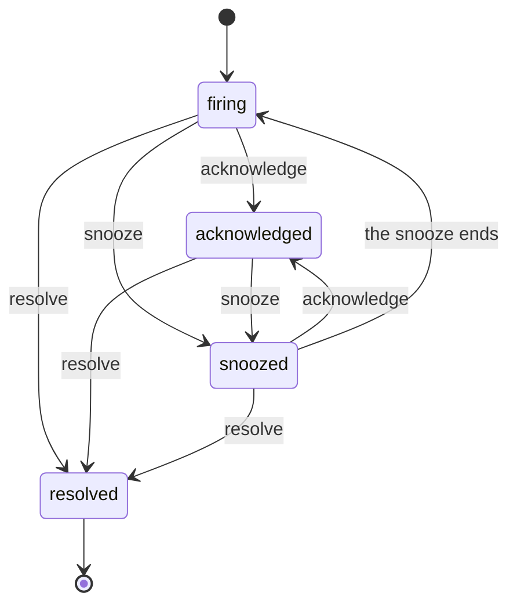

An alert is one problem reported by a source. This page describes the states it moves through and the timeline that records what happened to it. The tables are described in [[configuration-and-data-model]].

## States

| State | Meaning |
|---|---|
| `firing` | The problem is happening and nobody has taken it. Every new alert starts here. |
| `acknowledged` | Someone has taken responsibility for it. |
| `snoozed` | Someone asked not to be bothered until a given time. |
| `resolved` | The problem is over. This state is final. |

Only the moves in the diagram are allowed. Anything else is refused and changes nothing, including an action that would leave the alert where it is, such as acknowledging an acknowledged alert.

- **Snooze** needs an end time in the future. When it passes, Beacon returns the alert to `firing` by itself, within a few seconds.
- **Resolve** can come from a person or from the source. A resolved alert never changes again: if the source reports the same problem later, Beacon opens a new alert.
- While an alert is open, repeated deliveries of it from the source refresh its labels, annotations, severity and the time it was last received. They do not change its state.

## Severity

Every alert has one of three fixed levels: `critical`, `warning` or `info`.

## Timeline

Every state change is recorded as an event on the alert's timeline, in the same database transaction as the change. An event is never edited or removed.

| Event | Written when |
|---|---|
| `fired` | The alert is opened |
| `acknowledged` | Someone acknowledges it |
| `snoozed` | Someone snoozes it; the event holds the end time |
| `snooze_ended` | The snooze runs out and the alert fires again |
| `resolved` | A person or the source resolves it |

Notifications add their own events to the same timeline.

Each event has the time it happened and an actor:

| Actor | Who |
|---|---|
| `source` | The source that sent the alert or its resolution |
| `user` | A person. When they acted from a chat service and their account there is not linked to a Beacon user yet, the event holds the chat service and their identifier in it, so it can be attributed once the link exists. |
| `api_token` | A client using an API token |
| `system` | Beacon itself, for example when a snooze ends |
