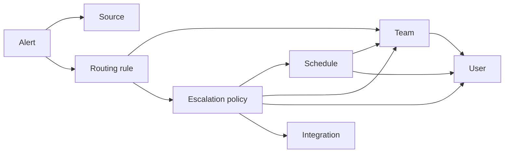

This page proposes the shape of Beacon's YAML configuration files and its Postgres tables, so that later work builds on an agreed design. It follows the decisions in [[requirements]] and does not change them.

> [!warning] Proposal for review
> Nothing here is final. The judgement calls are collected under [Decisions for review](#decisions-for-review) and [Open questions](#open-questions). Field and table names may change until the configuration loader and the first tables are merged.

## Overview

Beacon has three kinds of settings and state. Each has exactly one place where it is changed.

| Kind | Where it lives | Changed by | Examples |
|---|---|---|---|
| Process settings | Environment variables and flags | The operator, per deployment | Listen address, database URL, log level |
| Provisioned objects and sign-in settings | YAML files | A reviewed change in version control | Sources, integrations, teams, schedules, escalation policies, routing, the identity provider |
| Runtime state | Postgres | The UI, the API, chat actions and Beacon itself | Users, alerts, silences, overrides, shifts, notifications |

The running process evaluates provisioned objects from the files it loaded. It also copies them into Postgres, for two reasons: runtime rows need something stable to reference, and the API must be able to show an object that history refers to after it has left the files.

## Configuration files

### Layout

- Beacon is given a path with `--config` (or `BEACON_CONFIG`). The path is one YAML file or a directory. A directory is read recursively, taking every `*.yaml` and `*.yml` file in lexical order. Files and directories whose names start with a dot are skipped, which also keeps the bookkeeping directories of a Kubernetes ConfigMap volume from being read as a second copy.
- Every file is one YAML document with the same shape: top-level keys named after the object kinds, each holding a list. A file may contain any subset of the keys. Lists from all files are concatenated, so a team can keep its schedule, policy and routing rules together in one file.
- `routing` is the exception. Its `rules` are ordered, so the whole `routing` block must be in a single file.
- Unknown fields are an error. So is the same name used twice within a kind, in any file.

### Common rules

| Rule | Detail |
|---|---|
| Names | Every object has a `name`, unique within its kind. Lowercase letters, digits and hyphens, starting with a letter, at most 63 characters. The name is the identity: renaming an object removes the old one and creates a new one. |
| References | Objects refer to each other by `name`. Users are referred to by email address. |
| Durations | Prometheus style: `30s`, `5m`, `12h`, `1d`, `1w`. Units may be combined from largest to smallest, as in `1h30m`. |
| Secrets | Never inline. A secret field takes `{env: NAME}` or `{file: /path}`. A plain string in a secret field is an error, and the error does not repeat it. A relative file path is taken from the directory of the configuration file that names it, and a trailing newline in the file is dropped. Values are read when the configuration is loaded and are never stored: the database copy keeps the reference. |
| Dates and times | RFC 3339 with a zone, such as `2026-01-05T09:00:00Z`. |
| Time zones | IANA names such as `Europe/London`. |

### Sources

A source is an authenticated endpoint that receives alerts. Its URL is `/api/v1/ingest/<name>`.

| Field | Required | Meaning |
|---|---|---|
| `name` | yes | Identity, and the last segment of the ingest URL |
| `type` | yes | `alertmanager`, `grafana` or `webhook` |
| `token` | yes | Secret that the sender presents as a bearer token |
| `labels` | no | Labels added to every alert from this source. They do not replace a label the alert already has. |
| `severity` | no | How to derive severity; see below |

`severity.label` names the label that carries severity (default `severity`). `severity.mapping` maps label values to Beacon's levels `critical`, `warning` and `info`. `severity.default` applies when the label is missing or unmapped (default `warning`).

### Integrations

An integration is a connection to a notification service. Other objects name it when they want a notification sent through it.

| Field | Required | Meaning |
|---|---|---|
| `name` | yes | Identity |
| `type` | yes | `slack`, `discord`, `email` or `webhook` |
| `slack` / `discord` / `email` / `webhook` | yes | Settings for the type; exactly the block matching `type` must be present |

| Type | Settings |
|---|---|
| `slack` | `bot_token` (secret), `signing_secret` (secret) |
| `discord` | `bot_token` (secret), `public_key`, `application_id` |
| `email` | `host`, `port`, `username`, `password` (secret), `from`, `tls` (`starttls`, `implicit` or `none`) |
| `webhook` | `url`, `headers` (map; each value is a plain string or a secret reference) |

### Teams

| Field | Required | Meaning |
|---|---|---|
| `name` | yes | Identity |
| `display_name` | no | Shown in the UI; defaults to `name` |
| `members` | no | List of user email addresses |
| `groups` | no | Identity provider group names whose members belong to this team |

A team's membership is the union of `members` and the users whose identity provider groups match `groups`. See [Team membership](#team-membership).

### Schedules

A schedule is one rotation. Layered schedules are a later requirement.

| Field | Required | Meaning |
|---|---|---|
| `name` | yes | Identity |
| `team` | yes | Owning team |
| `time_zone` | yes | Zone in which `handoff` is read |
| `rotation.members` | yes | Ordered list of user email addresses |
| `rotation.shift_length` | yes | A whole number of days or weeks: `1d`, `1w`, `2w`, `3d` |
| `rotation.handoff.time` | yes | Local time of the handoff, `"HH:MM"` |
| `rotation.handoff.day` | if weeks | Weekday of the handoff, for shift lengths in weeks |
| `effective_from` | no | Date and time at which a changed definition takes over. Without it, the change applies at the next handoff. |

The file states the intent only. It has no start date and no "current person"; those are the schedule's position, kept in the database. See [Schedule position](#schedule-position).

### Escalation policies

| Field | Required | Meaning |
|---|---|---|
| `name` | yes | Identity |
| `repeat` | no | How many more times to run all steps after the first pass (default `0`) |
| `steps` | yes | Ordered list, at least one |
| `steps[].notify` | yes | List of targets, at least one |
| `steps[].timeout` | yes | How long to wait for an acknowledgement before the next step |

Each target is a map with exactly one of these forms:

| Target | Who is notified |
|---|---|
| `{schedule: <name>}` | Whoever is on call for the schedule, taking overrides into account |
| `{team: <name>}` | Every member of the team |
| `{user: <email>}` | One user |
| `{channel: <channel>, integration: <name>}` | A shared channel, for example a Slack channel |

People targets (`schedule`, `team`, `user`) accept an optional `via` list of integration names. Without it, the person is notified through every integration that can reach them directly: a Slack or Discord direct message when their account is linked, and email.

### Routing

| Field | Required | Meaning |
|---|---|---|
| `group_by` | no | Labels that define a group (default `[alertname]`) |
| `group_wait` | no | Wait before the first notification of a new group (default `30s`) |
| `group_interval` | no | Minimum time between updates for a group (default `5m`) |
| `default.team` | no | Team for alerts that match no rule |
| `default.escalation_policy` | yes | Policy for alerts that match no rule |
| `rules` | no | Ordered list; the first matching rule wins |

| Rule field | Required | Meaning |
|---|---|---|
| `name` | yes | Identity; recorded on each alert the rule matched |
| `match` | one of | Map of label to exact value; all must match |
| `match_re` | one of | Map of label to regular expression, anchored at both ends; all must match |
| `team` | no | Team the alert is assigned to |
| `service` | no | Service name the alert is assigned to; defaults to the alert's `service` label |
| `escalation_policy` | yes | Policy to run |
| `group_by`, `group_wait`, `group_interval` | no | Override the routing defaults for this rule |

A service is a plain name on an alert, used for filtering and as a metric label. It is not a provisioned object in the MVP.

### Sign-in

`auth` is one group of settings, not a kind of object: it has no name, is not copied into the database, and must be in a single file. [[access]] describes its fields.

```yaml
auth:
  public_url: https://beacon.example.com
  session_lifetime: 12h
  oidc:
    issuer: https://idp.example.com
    client_id: beacon
    client_secret: {env: BEACON_OIDC_CLIENT_SECRET}
    groups_claim: groups
  roles:
    admin: [beacon-admins]
    member: [beacon-users]
```

The first version of this design listed the identity provider client under process settings. It moved into the files because issue 19 asks for it there, and because it then follows the same review, validation and reload as everything else.

### Worked example

```yaml
# beacon.d/platform.yaml

sources:
  - name: prod-alertmanager
    type: alertmanager
    token: {env: BEACON_SOURCE_PROD_ALERTMANAGER_TOKEN}
    labels:
      environment: production
    severity:
      label: severity
      mapping:
        page: critical
        critical: critical
        warning: warning
      default: warning

  - name: grafana
    type: grafana
    token: {file: /run/secrets/grafana-source-token}

integrations:
  - name: slack
    type: slack
    slack:
      bot_token: {env: BEACON_SLACK_BOT_TOKEN}
      signing_secret: {env: BEACON_SLACK_SIGNING_SECRET}

  - name: email
    type: email
    email:
      host: smtp.example.com
      port: 587
      username: beacon
      password: {env: BEACON_SMTP_PASSWORD}
      from: beacon@example.com
      tls: starttls

teams:
  - name: platform
    display_name: Platform
    members:
      - ada@example.com
      - grace@example.com
      - linus@example.com
    groups:
      - platform-engineers

schedules:
  - name: platform-primary
    team: platform
    time_zone: Europe/London
    rotation:
      members:
        - ada@example.com
        - grace@example.com
        - linus@example.com
      shift_length: 1w
      handoff:
        day: monday
        time: "09:00"

escalation_policies:
  - name: platform-default
    repeat: 2
    steps:
      - notify:
          - schedule: platform-primary
          - channel: "#platform-alerts"
            integration: slack
        timeout: 5m
      - notify:
          - team: platform
        timeout: 10m
      - notify:
          - user: ada@example.com
            via: [email]
        timeout: 15m

routing:
  group_by: [alertname, cluster]
  group_wait: 30s
  group_interval: 5m
  default:
    team: platform
    escalation_policy: platform-default
  rules:
    - name: platform-critical
      match:
        team: platform
      match_re:
        severity: critical|page
      team: platform
      escalation_policy: platform-default
```

## References between objects



| From | Field | To | If the target is missing |
|---|---|---|---|
| Routing rule, routing default | `team` | Team | Validation error |
| Routing rule, routing default | `escalation_policy` | Escalation policy | Validation error |
| Escalation step | `schedule` | Schedule | Validation error |
| Escalation step | `team` | Team | Validation error |
| Escalation step | `integration`, `via` | Integration | Validation error |
| Schedule | `team` | Team | Validation error |
| Team | `members` | User, by email | Skipped and logged as an error; added once the user exists |
| Schedule | `rotation.members` | User, by email | Skipped in the rotation and logged as an error; takes their place once the user exists |
| Escalation step | `user` | User, by email | Skipped and logged as an error when the step runs |

References between provisioned objects are checked by `beacon validate` without a database. References to users cannot be, because users exist only in the database; they are resolved when configuration is applied and again when a user first signs in.

## Provisioned and runtime boundary

Provisioned objects are read-only in the UI and the API. Runtime state is never written from files.

| Object | Managed as | Stored in Postgres | Notes |
|---|---|---|---|
| Source | Provisioned | Copy, for references | Secrets are not copied |
| Integration | Provisioned | Copy, for references | Secrets are not copied |
| Team | Provisioned | Copy, for references | |
| Team membership | Both | Yes | From the `members` list (provisioned) and from identity provider groups (runtime, at sign-in) |
| Schedule definition | Provisioned | Copy, plus the definition in force | |
| Schedule position | Runtime | Yes | Who is on call and since when |
| Shift | Runtime | Yes | Written as it happens, never recomputed |
| Schedule override | Runtime | Yes | |
| Escalation policy | Provisioned | Copy, for references | |
| Escalation progress | Runtime | Yes | Current step and timer per alert group |
| Routing rule | Provisioned | Copy, for references | |
| User | Runtime | Yes | Created on first sign-in |
| Linked Slack and Discord identity | Runtime | Yes | |
| Role (admin or member) | Runtime | Yes | Set from identity provider claims at each sign-in |
| API token | Runtime | Yes | Hash only |
| Alert, alert group | Runtime | Yes | |
| Alert event (timeline) | Runtime | Yes | Append only |
| Notification and delivery attempt | Runtime | Yes | |
| Silence | Runtime | Yes | |

## Database tables

Conventions:

- Primary keys are `uuid`, defaulting to `gen_random_uuid()`. Append-only log tables use `bigint` identity keys instead, so they stay in insertion order.
- All times are `timestamptz`. Tables have `created_at`, and `updated_at` where rows change.
- States are `text` with a `CHECK` constraint, not Postgres enum types, so adding a value is an ordinary migration.
- Labels, annotations and object definitions are `jsonb`.
- No Postgres extensions are required.

### Provisioned objects

`sources`, `integrations`, `teams`, `schedules`, `escalation_policies` and `routing_rules` share one shape.

| Column | Type | Notes |
|---|---|---|
| `id` | `uuid` | Primary key; what runtime rows reference |
| `name` | `text` | Unique among rows that are not removed |
| `spec` | `jsonb` | The object as loaded, with secret references left unresolved |
| `spec_hash` | `text` | Lets reconciliation skip unchanged objects |
| `provisioned` | `boolean` | True for a row that the configuration files own. The API and the UI treat such a row as read-only, and reconciliation manages only these rows. Every row is provisioned today; the column is there for the later option of editing objects in the UI. |
| `created_at`, `updated_at` | `timestamptz` | |
| `removed_at` | `timestamptz` | Set when the object leaves the files; the row is kept so history still resolves |

`routing_rules` also has `position integer`. `schedules` also has `team_id`.

A removed object keeps its row. If an object with the same name returns, the same row is revived, so history stays attached to it.

### Reconciliation

Applying a configuration makes these rows match the files, in one transaction, so the database never holds half a configuration:

- An object that has no row is created. One whose definition changed is updated; an unchanged one is not written at all.
- An object that left the files gets `removed_at`. Nothing is deleted, whether or not anything refers to the row, so an alert, a notification or a shift always resolves to the object it belonged to.
- Kinds are applied in dependency order (sources, integrations, teams, schedules, escalation policies, routing rules), so a schedule's `team_id` always has a row to point at.
- A transaction-level advisory lock serialises reconciliations. Replicas that start together take turns, and all but the first find nothing to do.
- Reconciliation runs at start and at every reload. A reload validates the files first and reconciles before anything in the process is switched over, so a configuration that is invalid, or that cannot be stored, changes nothing.
- Replicas are expected to run the same configuration. If two run different files, each makes the rows match its own files in turn, and the last one wins; roll out a configuration change to every replica.

### Users and access

**`users`**

| Column | Type | Notes |
|---|---|---|
| `id` | `uuid` | |
| `email` | `text` | Stored lowercase; unique |
| `display_name` | `text` | |
| `role` | `text` | `admin` or `member` |
| `oidc_issuer`, `oidc_subject` | `text` | Unique together; null for the bootstrap admin |
| `created_at`, `updated_at`, `last_sign_in_at` | `timestamptz` | |
| `disabled_at` | `timestamptz` | |

**`sessions`**: `id`, `token_hash`, `user_id`, `created_at`, `expires_at`. One row per signed-in browser. The cookie holds a random token and the row holds its SHA-256 hash, so every replica accepts a session and reading the table does not let anyone take one over. A session has a fixed lifetime and is deleted at sign-out.

**`sign_in_flows`**: `state_hash`, `nonce`, `code_verifier`, `created_at`, `expires_at`. A sign-in that has been sent to the identity provider and has not come back. A row is used once and lives ten minutes. Keeping it in Postgres, not in a signed cookie, means there is no session key to manage and the callback can arrive at any replica.

**`user_identities`**: `user_id`, `provider` (`slack` or `discord`), `external_id`, `created_at`. Unique on (`provider`, `external_id`) and on (`user_id`, `provider`).

**`team_members`**: `team_id`, `user_id`, `origin` (`config` or `group`), `created_at`. Primary key on all three of `team_id`, `user_id`, `origin`.

**`api_tokens`**: `id`, `name`, `token_hash`, `role`, `created_by`, `created_at`, `expires_at`, `last_used_at`, `revoked_at`. The token is 256 random bits behind the prefix `bcn_`, shown once; `token_hash` is its SHA-256, which is enough for a secret that cannot be guessed. `created_by` is null for a token created with another token. `last_used_at` is exact to the minute, so a busy token does not write its row on every request. A revoked token keeps its row.

The **bootstrap admin** has a row in `users` with the email address `bootstrap-admin@beacon.invalid`, the admin role and no issuer or subject. Its password is not in the database at all: the configuration gives Beacon a bcrypt hash through a secret reference (`auth.bootstrap_admin.password_hash`). Removing that from the configuration sets the row's `disabled_at` and deletes its sessions.

### Alerts

**`alerts`**

| Column | Type | Notes |
|---|---|---|
| `id` | `uuid` | |
| `source_id` | `uuid` | References `sources` |
| `fingerprint` | `text` | |
| `status` | `text` | `firing`, `acknowledged`, `snoozed` or `resolved` |
| `severity` | `text` | `critical`, `warning` or `info` |
| `labels`, `annotations` | `jsonb` | |
| `links` | `jsonb` | Web addresses the source sent with the alert, by name: `generator`, and for Grafana `dashboard`, `panel` and `silence`. Added with the Alertmanager receiver (issue 23); the first version of this design had nowhere to keep them. |
| `group_id` | `uuid` | References `alert_groups` |
| `routing_rule_id` | `uuid` | Null when the default applied |
| `team_id` | `uuid` | Nullable |
| `service` | `text` | Nullable |
| `started_at`, `last_received_at` | `timestamptz` | |
| `acknowledged_at`, `acknowledged_by` | | |
| `snoozed_until` | `timestamptz` | |
| `resolved_at` | `timestamptz` | |

A unique index on (`source_id`, `fingerprint`) for rows whose status is not `resolved` makes deduplication safe under concurrent deliveries, and lets a resolved alert that fires again open a new row.

`acknowledged_by` references `users` and is set only when a Beacon user acknowledged. Someone who acts from chat before their account is linked is recorded on the timeline event instead.

**`alert_groups`**: `id`, `group_key` (hash of the routing rule and the `group_by` label values), `routing_rule_id`, `team_id`, `escalation_policy_id`, `status` (`open` or `resolved`), `created_at`, `resolved_at`. Unique on `group_key` for open groups.

> [!note] Built up over several migrations
> The first migration for these tables leaves out the columns that reference tables which do not exist yet: `routing_rule_id`, `team_id` and `escalation_policy_id`. The migrations that create those tables add them. Until grouping is implemented, every alert gets a group of its own, keyed by a hash of its source and fingerprint.

**`escalations`**: one row per open alert group. `alert_group_id`, `escalation_policy_id`, `step_index`, `pass` (which repeat), `next_step_at`, `status` (`active`, `acknowledged`, `exhausted` or `resolved`). Workers claim due rows with `SELECT ... FOR UPDATE SKIP LOCKED`, so a timer fires once when several replicas run.

**`alert_events`** (append only)

| Column | Type | Notes |
|---|---|---|
| `id` | `bigint` | Identity |
| `alert_id` | `uuid` | Nullable for events about a whole group |
| `alert_group_id` | `uuid` | |
| `type` | `text` | `fired`, `acknowledged`, `snoozed`, `snooze_ended`, `resolved`, `escalated`, `notification_sent`, `notification_failed` and so on |
| `actor_type` | `text` | `user`, `api_token`, `source` or `system` |
| `actor_id` | `uuid` | Nullable |
| `actor_provider`, `actor_external_id` | `text` | Nullable, set together. The chat account of a person who acted from Slack or Discord, in the same form as `user_identities`. `actor_id` stays null until that account is linked to a user. |
| `occurred_at` | `timestamptz` | |
| `data` | `jsonb` | Details specific to the type |

**`silences`**: `id`, `matchers` (`jsonb`: list of label, operator, value), `starts_at`, `ends_at`, `created_by`, `comment`, `created_at`. Expiring a silence early sets `ends_at` to now.

### Notifications

**`notifications`**: the durable queue. One row per message to one destination.

| Column | Type | Notes |
|---|---|---|
| `id` | `uuid` | |
| `alert_group_id` | `uuid` | |
| `integration_id` | `uuid` | |
| `user_id` | `uuid` | Null for channel targets |
| `destination` | `text` | Channel, address or URL, resolved when queued |
| `reason` | `text` | `escalation_step`, `group_update`, `resolved` |
| `status` | `text` | `pending`, `sent` or `failed` |
| `attempts` | `integer` | |
| `next_attempt_at` | `timestamptz` | Workers claim due rows with `SKIP LOCKED` |
| `external_ref` | `text` | Message identifier from the service, so the message can be updated later |
| `created_at`, `sent_at` | `timestamptz` | |

A worker claims a due row by moving its `next_attempt_at` into the future in the same statement that selects it with `SKIP LOCKED`. The row stays `pending` and hidden from other workers until the attempt is recorded. If the worker dies, the row becomes due again when that time passes. [[notifications]] describes the delivery rules.

**`notification_attempts`** (append only): `id` (`bigint`), `notification_id`, `attempted_at`, `outcome` (`success`, `retryable_error` or `permanent_error`), `error`.

### Schedules

**`schedule_positions`**: one row per schedule.

| Column | Type | Notes |
|---|---|---|
| `schedule_id` | `uuid` | Primary key |
| `user_id` | `uuid` | Who is on call under the rotation, ignoring overrides |
| `shift_started_at` | `timestamptz` | |
| `next_handoff_at` | `timestamptz` | |
| `definition` | `jsonb` | The rotation in force, which may be older than the file |
| `pending_definition` | `jsonb` | A changed rotation waiting to take over; nullable |
| `pending_effective_at` | `timestamptz` | |

**`shifts`**: `id`, `schedule_id`, `user_id`, `starts_at`, `ends_at`, `kind` (`rotation` or `override`), `override_id`. A row is inserted when a shift begins, with `ends_at` null, and closed at the handoff. Rows are never updated after they are closed.

**`schedule_overrides`**: `id`, `schedule_id`, `user_id`, `starts_at`, `ends_at`, `created_by`, `reason`, `created_at`, `cancelled_at`.

## Team membership

Membership is the union of two origins, and each origin manages only its own rows in `team_members`:

- **`config`**: applying configuration makes the `config` rows of a team equal its `members` list. An email with no user is skipped, logged as an error and counted in the metric `beacon_team_members_skipped`; the rest of the configuration is applied. At every sign-in, Beacon makes that user's `config` rows equal the teams whose loaded `members` list names their address: that adds the rows that were skipped when the user did not exist yet, and moves them when the provider changed the address. A team that leaves the files loses its `config` rows.
- **`group`**: at every sign-in, the user's `group` rows are replaced with the teams whose `groups` match the groups in the user's token. Leaving a group in the identity provider removes that membership at the next sign-in. A sign-in that is refused because the person is in no group with a role removes all their `group` rows and ends their sessions.

A user is a member if either row exists. Removing someone from `members` does not remove them while their identity provider group still maps to the team, and the reverse.

## Schedule position

- The position is the person, not an index into the list. `schedule_positions.user_id` and `shift_started_at` say who is on call and since when.
- At each handoff Beacon closes the current row in `shifts`, picks the next person, and opens a new row. The next person is the member after the current one in the definition in force, wrapping at the end.
- A changed definition in the files is stored as `pending_definition`. It takes over at the next handoff, or at `effective_from`. Until then the definition in force keeps running, so the shift in progress is not touched.
- When the pending definition takes over, the rotation continues from the current person: the next person is whoever follows them in the new order. If the current person is no longer in the list, the next person is the first member of the new list who came after them in the old order.
- A new schedule starts with the first member, at the moment it is first applied. Its first handoff is the next occurrence of the handoff time that is at least one full shift length away, so the first shift is never shorter than a normal one.
- The handoff is a local time in the schedule's zone. Each handoff instant is computed from the calendar date, so a daylight saving change moves the instant and not the local time.

## Decisions for review

These are judgement calls made in this proposal. Each can be changed before the configuration loader (issue 15) and the tables that depend on it are built.

| # | Decision | Alternative considered |
|---|---|---|
| 1 | Files use top-level keys per kind holding lists, as Prometheus and Alertmanager do | One Kubernetes-style document per object, with `kind` and `metadata` |
| 2 | A config path is one file or a directory read recursively; objects may be split across files in any way, except `routing` | One fixed file per kind |
| 3 | Objects are identified by `name`; a rename is a removal and a creation | A separate immutable `id` field in the files |
| 4 | Users are referred to by email address | By identity provider subject or a Beacon username |
| 5 | Team membership is the union of the `members` list and identity provider group mapping, tracked per origin | The list in configuration wins when present; or the two are mutually exclusive per team |
| 6 | Group mapping for teams is written on the team (`groups`) | A separate mapping section next to the identity provider settings |
| 7 | Schedule position is stored as the on-call person and shift start, with the definition in force kept beside it | Store an index and an anchor date, and compute shifts |
| 8 | A new schedule starts with the first member, and the first shift is at least one full shift long | An optional `start` field in the file |
| 9 | Notifications and escalation attach to an alert group, not to each alert | Escalate each alert separately and use groups only to batch messages |
| 10 | Provisioned objects are copied into one table per kind with a `jsonb` definition, and removed objects keep their row | One generic table for all kinds; or fully normalised tables per kind |
| 11 | Routing rules are a flat ordered list where the first match wins | A nested routing tree as in Alertmanager |
| 12 | Keys are random `uuid` values, with `bigint` identity for append-only logs; no extensions | Time-ordered UUIDs, which need a newer minimum Postgres version or generation in the application |
| 13 | Escalation steps name their targets, and people are reached through every integration that can reach them unless `via` narrows it | Per-user notification rules, which are a later requirement |
| 14 | Severity levels are fixed: `critical`, `warning`, `info` | Configurable levels |

## Open questions

1. **Roles from the identity provider.** *Resolved (issues 19 and 20), for the project owner to confirm:* the identity provider's settings, the role mapping (`auth.roles.admin`, `auth.roles.member`) and the name of the claim (`auth.oidc.groups_claim`) live in the `auth` block in YAML. The alternative was process settings beside the client identifier; the files won because the mapping names groups just as `teams[].groups` does, and belongs in the same review. A person in no mapped group has no access; with no mapping at all, everyone is a member and nobody an admin.
2. **A user's email address changes.** *Resolved for now (issue 19), for the project owner to confirm:* a user is identified by the provider's issuer and subject, so the account and its history survive a change of address, and the stored address is updated at the next sign-in. The files must then be changed to the new address; until they are, the old address in a team or rotation is an unknown user and is skipped. The alternative is to let the files name a stable identifier, which nobody could write by hand.
3. **Unknown users in a rotation.** The requirements say an unknown user in a team is skipped and logged. This proposal applies the same rule to rotation members. The alternative is to treat it as an error that blocks applying the schedule, since a skipped member changes who is on call.
4. **Must rotation members belong to the owning team?** The proposal does not require it, so someone from another team can cover. Requiring it would catch mistakes.
5. **Service as an object.** Routing can assign a service name, but nothing else is attached to a service. Should services become provisioned objects with an owning team before the MVP, or stay as names?
6. **Shared channels for a team.** A shared channel is named in each escalation step. Should a team have a default channel, so that policies need not repeat it?
7. **Minimum Postgres version.** No feature here needs a recent version. Stating a minimum (for example the oldest release still supported upstream) would let later work rely on it.
8. **Retention.** `alert_events`, `notification_attempts` and `shifts` grow without bound. Is a retention setting needed for the MVP, or is it left to the operator?
9. **Sessions.** *Resolved (issue 19), for the project owner to confirm:* a `sessions` table holding a hash of an opaque random token, with a fixed lifetime (`auth.session_lifetime`, 12 hours by default) and no refresh. The alternative, a signed or encrypted cookie that carries the session, needs a key shared by all replicas and cannot be revoked at sign-out without a table anyway.
