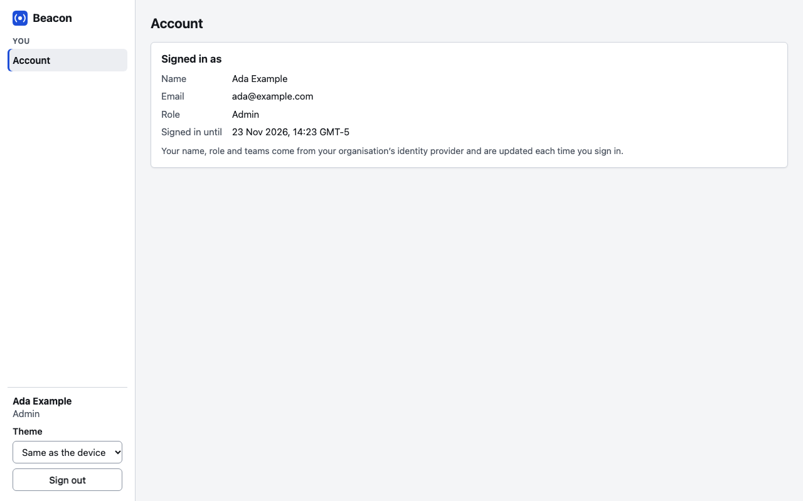
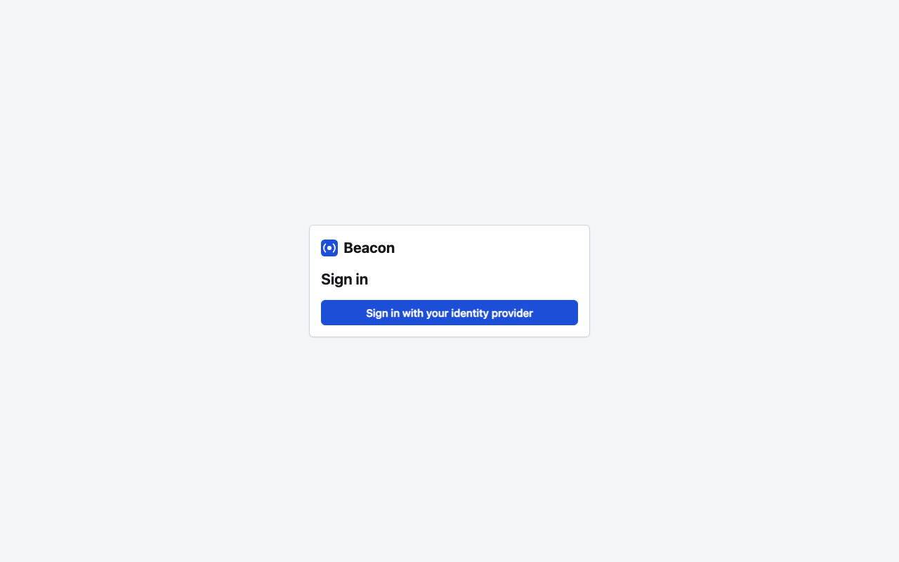
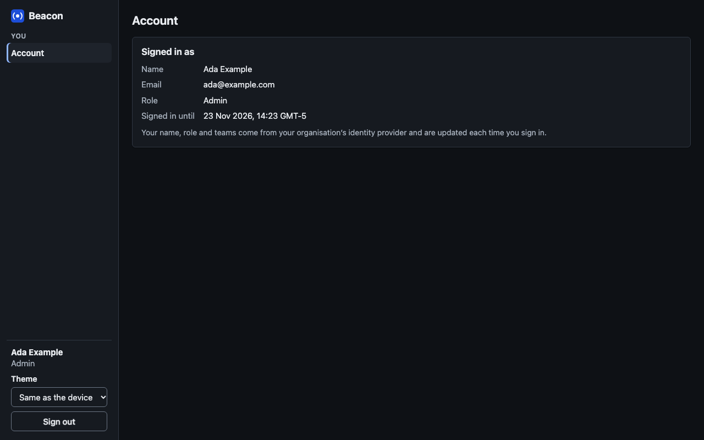
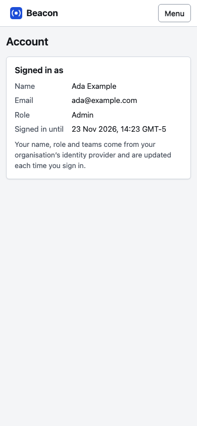

Beacon has a web interface: open Beacon's address in a browser and sign in. It is a single-page app on the [[api|REST API]], and does nothing the API does not: everything it shows it reads there, with your session, and everything it changes it changes there. It is part of the binary, so there is nothing more to install or to serve.



## Signing in

A page of the app that you open without a session shows the sign-in page in its place, and takes you to the page you asked for once you are signed in. A link to an alert therefore works whether or not you are signed in when you follow it.



The page offers the ways to sign in that the configuration has ([[access]]): the identity provider, the [[access#Bootstrap admin|bootstrap admin]]'s password, or both. With neither it says that nobody can sign in yet.

**Sign out** is at the foot of the navigation. It ends the session in Beacon, not only in the browser. When a session runs out while the app is open, the sign-in page comes back and says so.

> [!note] A sign-in that the provider or Beacon refuses
> A refusal at the end of a sign-in, such as "you are not in a group that has access to Beacon", is answered by the sign-in route itself, as JSON, not by a page of the app. Go back to Beacon's address to try again.

## What it shows

| Page | What is there |
|---|---|
| Account | Who you are signed in as, your role, and until when the session lasts |

The pages for alerts, schedules, silences and what the configuration defines follow; this page grows with them.

What the configuration files define is read-only in the app, as in the API: it is changed in the files ([[configuration]]).

## Look and use

- **Themes.** Light and dark. The app follows the device until you choose one under **Theme**; the choice is kept in the browser.
- **Small screens.** Every page works at the width of a phone; the navigation is behind **Menu** there.
- **Keyboard.** Everything can be reached and used with the keyboard. The first stop of the Tab key on every page skips the navigation.
- **Times** are shown in the time zone of your device, with the zone named.





## What the browser is given

- **The app is public; what it shows is not.** The page, its script and its style sheet are served to anyone who asks, like the sign-in routes: they are the files of an open-source project and hold nothing of an install. Everything else comes from the API, which answers `401` without a session. An address under `/api/` or `/auth/` is never answered with the page, so a mistyped API address is still `401` and JSON.
- **The session is a cookie that scripts cannot read** (`HttpOnly`, `SameSite=Lax`, and `Secure` over https). The app keeps no token, and nothing that stands for the session, in the browser's storage. It keeps two things there: the theme you chose, and, for the length of a sign-in, the page you had asked for.
- **Requests that change something** pass the same cross-site check as every other request with a session ([[access]]): the browser says they come from Beacon's own pages.
- **A Content-Security-Policy** lets the page load scripts, styles, images and fonts from Beacon alone, with no inline script or style, talk to Beacon alone, and be shown in no frame. `X-Content-Type-Options: nosniff`, `X-Frame-Options: DENY` and `Referrer-Policy: no-referrer` are set as well.
- **Nothing is loaded from another host**: no fonts, no scripts, no analytics. A browser that can reach Beacon needs to reach nothing else.
- **Caching.** The script and the style sheet have a hash of their content in their name and are kept by the browser for good; the page itself is asked about again at every visit, so a new release is picked up at once.

If Beacon is behind a proxy that sets security headers of its own, let Beacon's through for the app, or set a policy at least as strict.

## For an install

Nothing to do. The release image has the app in it, and `beacon serve` serves it at every address that is not the API's. `auth.public_url` is the address people open.

A binary that was built from source without building the app first says so in its log at start (`this binary was built without the web interface`) and shows a short notice in place of the app. The API works either way.

## Development

The app is in `web/`: React and TypeScript, built by Vite. Node is pinned in `.tool-versions` with the other tools; npm comes with it.

```sh
cd web
npm ci
npm run build        # type check, then build into internal/web/dist
cd .. && go build -o bin/beacon ./cmd/beacon   # the binary now has the app in it
```

**Go alone needs no Node.** `go build ./...` and `go test ./...` work in a checkout where the app was never built: the binary then has no app, and the one test that needs it is skipped (and fails in CI, where the app is always built first).

To work on the app, run a Beacon and the development server, which serves the app with hot reload and passes `/api` and `/auth` on to that Beacon, so the browser sees one origin as in a release:

```sh
docker compose up -d --wait postgres dex mailpit
go build -o bin/beacon ./cmd/beacon
cd web
npm run dev:beacon   # a Beacon on 127.0.0.1:18080 with a database of its own and the Dex users
npm run dev          # in another terminal: the app on http://127.0.0.1:5173
```

Sign in as `ada@example.com` (an admin) or `grace@example.com` (a member), both with the password `password`; they are the users of the Dex in `compose.yaml`. `BEACON_URL` points the development server at another Beacon.

| Command, in `web/` | What it does |
|---|---|
| `npm run typecheck` | Type check |
| `npm run lint` | ESLint |
| `npm test` | Unit and component tests (Vitest, Testing Library) |
| `npm run generate` | Regenerate `src/api/schema.d.ts` from `internal/api/openapi.yaml` |
| `npm run generate:check` | Fail if those types are stale; CI runs it |
| `npm run e2e` | The browser tests (Playwright), against `bin/beacon`; build the app and the binary first |

**The API types are generated.** The app calls the API through a client that is typed from the OpenAPI description, so a route, a parameter or a field that the API does not have does not compile. After a change to `internal/api/openapi.yaml`, run `npm run generate` and commit the result.

**The browser tests** start the real binary against a database of their own, sign in through Dex, and use the app as a person would. Each main view is also checked with [axe](https://github.com/dequelabs/axe-core) for accessibility, in both themes and at the width of a phone. `npx playwright install chromium` fetches the browser once.
