Beacon has a web interface: open Beacon's address in a browser and sign in. It is a single-page app on the [[api|REST API]], and does nothing the API does not: everything it shows it reads there, with your session, and everything it changes it changes there. It is part of the binary, so there is nothing more to install or to serve.


## Signing in

A page of the app that you open without a session shows the sign-in page in its place, and takes you to the page you asked for once you are signed in. A link to an alert therefore works whether or not you are signed in when you follow it.


The page offers the ways to sign in that the configuration has ([[access]]): the identity provider, the [[access#Bootstrap admin|bootstrap admin]]'s password, or both. With neither it says that nobody can sign in yet.

**Sign out** is at the foot of the navigation. It ends the session in Beacon, not only in the browser. When a session runs out while the app is open, the sign-in page comes back and says so.

> [!note] A sign-in that the provider or Beacon refuses
> A refusal at the end of a sign-in, such as "you are not in a group that has access to Beacon", is answered by the sign-in route itself, as JSON, not by a page of the app. Go back to Beacon's address to try again.

## What it shows

| Page | What is there |
|---|---|
| Alerts | The alerts, newest first, with filters for state, severity and team, and the buttons to acknowledge, snooze and resolve |
| An alert | What it says (labels, annotations, links), what routing decided for it, its group, and its timeline, with the same buttons |
| On call | Who is on call now, for every schedule, team by team |
| A schedule | Who is on call, the shifts of four weeks at a time, past and to come, its overrides, with the ways to add and remove one, and the rotation as the files define it |
| Silences | The silences in force and to come, and on request the expired ones; a form for a new one, with a preview of the open alerts it matches; and the way to expire one |
| Escalation policies | Each policy step by step: whom it notifies, how long it waits, how often it starts again |
| Routing | The rules in the order they are tried, with their conditions, team, service, policy and grouping, and the default route |
| Teams | Who belongs to each team and why, its identity provider groups and its schedules; for admins, the listed people who are not users yet |
| Sources and integrations | Where alerts come from and where notifications go, without any credential |
| Account | Who you are signed in as, your role, until when the session lasts, and your chat accounts, with the code to link a Discord account |
| API tokens | For admins: the tokens, a form for a new one, whose secret is shown once, and the way to revoke one |

What the configuration files define is read-only in the app, as in the API: it is changed in the files ([[configuration]]). Every such page says so at its top, and has nothing that can be pressed or typed into.

## Alerts

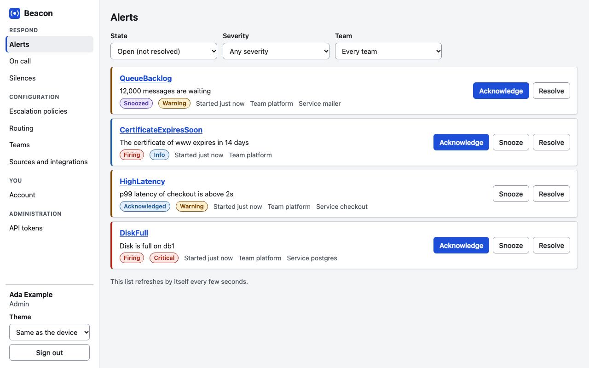

The list opens on the alerts that are not resolved. **State**, **Severity** and **Team** narrow it, and are part of the address, so a filtered list can be bookmarked or sent to someone. The list asks Beacon again every few seconds and when you come back to its tab: a new alert appears, and one that its source resolved goes, without a reload. If a refresh fails, the list stays and says that it may be out of date.

Each alert shows the buttons that its state allows ([[alert-lifecycle]]): **Acknowledge**, **Snooze** (for 30 minutes, 1 hour, 4 hours or a day) and **Resolve**. They do what the same buttons do in chat ([[slack#Who can act]]), for the one alert, as you: the timeline names you. If someone else was quicker, the page says what Beacon answered and shows the alert as it is.

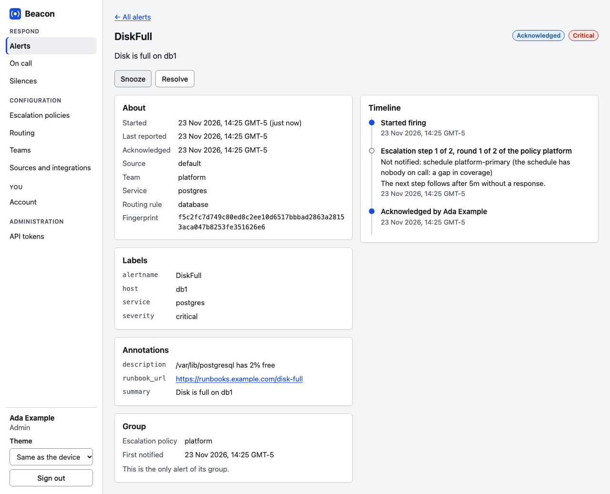

The page of an alert has its timeline: when it fired, each escalation step with who was notified and who could not be and why, each delivery and each failure, and who acknowledged, snoozed or resolved it and from where. The links in [[email|emails]] lead to this page.

> [!note] What an alert says is shown as text
> Labels, annotations and links are written by whoever can send alerts to Beacon. The app shows them as text, never as markup, and makes a link of an address only when it is an `http` or `https` address.

Acting on a whole group at once is in chat and in the API ([[api#Groups]]); the app acts on one alert at a time.

## On call and schedules

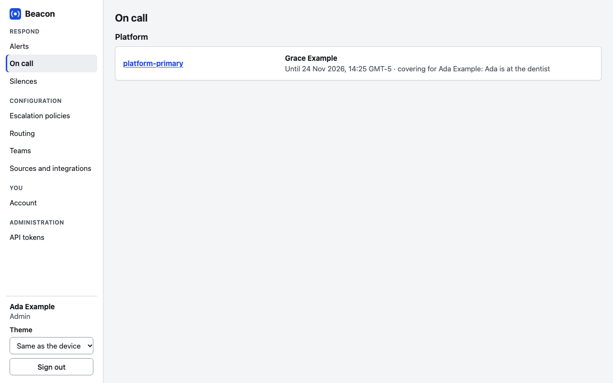

**On call** answers who is on call now ([[schedules#Who is on call]]) for every schedule, under the team that owns it: the person, until when, and, during an override, for whom they cover and why. It marks the schedules on which it is you. A schedule with nobody on call says so; that is a gap in coverage, not a fault ([[schedules]]).

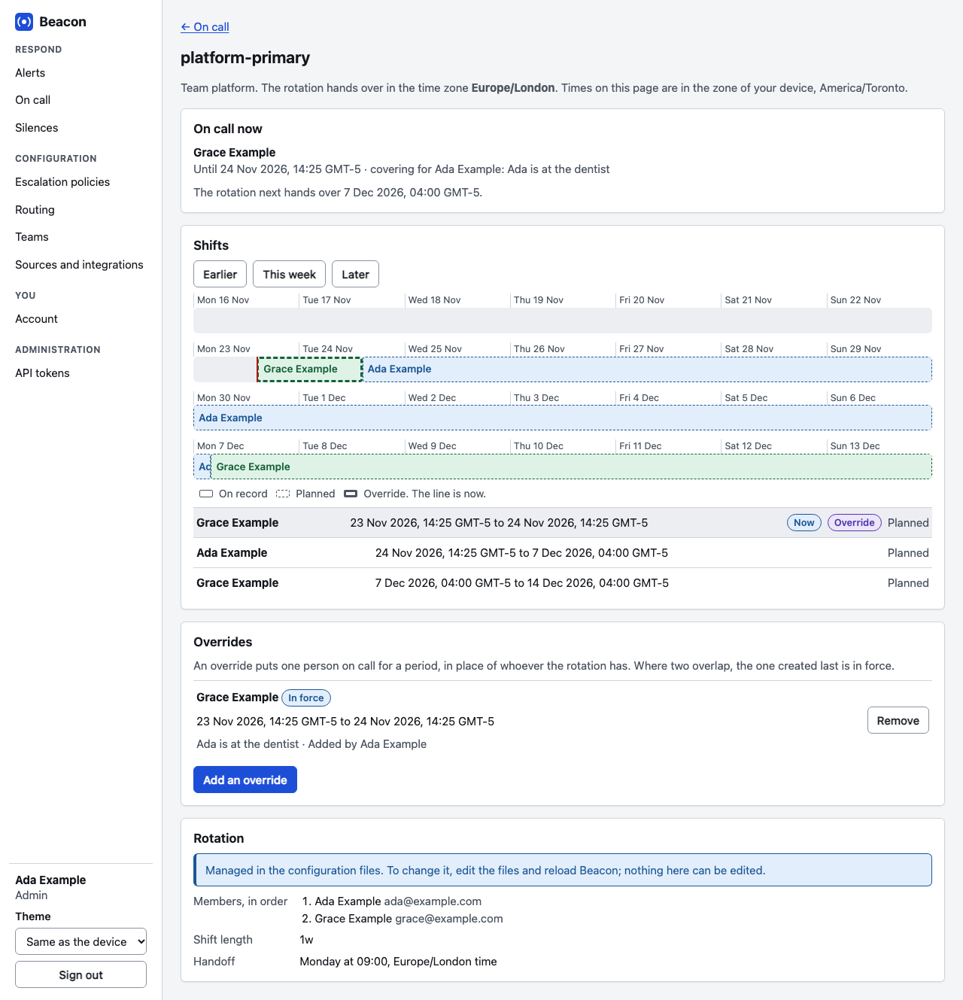

The page of a schedule shows four weeks at a time, starting with last week: a bar for each week and, below, the same shifts as a list. Shifts that are over come from the record and are never recomputed; the rest is the plan as the rotation and the overrides stand now. **Earlier** and **Later** move by four weeks, and the week is part of the address.

**Times are in the time zone of your device**, like everywhere in the app. A rotation hands over in the zone its schedule names, so the page states that zone, and a handoff at 09:00 in London is shown at 04:00 to someone in Toronto.

The **rotation** is shown as the files define it, with the members in order, and is marked as managed in the configuration files: it cannot be changed here. When the files hold a changed rotation that has not taken over yet, the page shows it too, with the moment it takes over ([[schedules#Changing a schedule]]).

### Overrides

An override puts someone on call for a period in place of whoever the rotation has ([[schedules#Overrides]]). The page of a schedule lists the overrides in force and to come, with who covers, when, why and who added each.

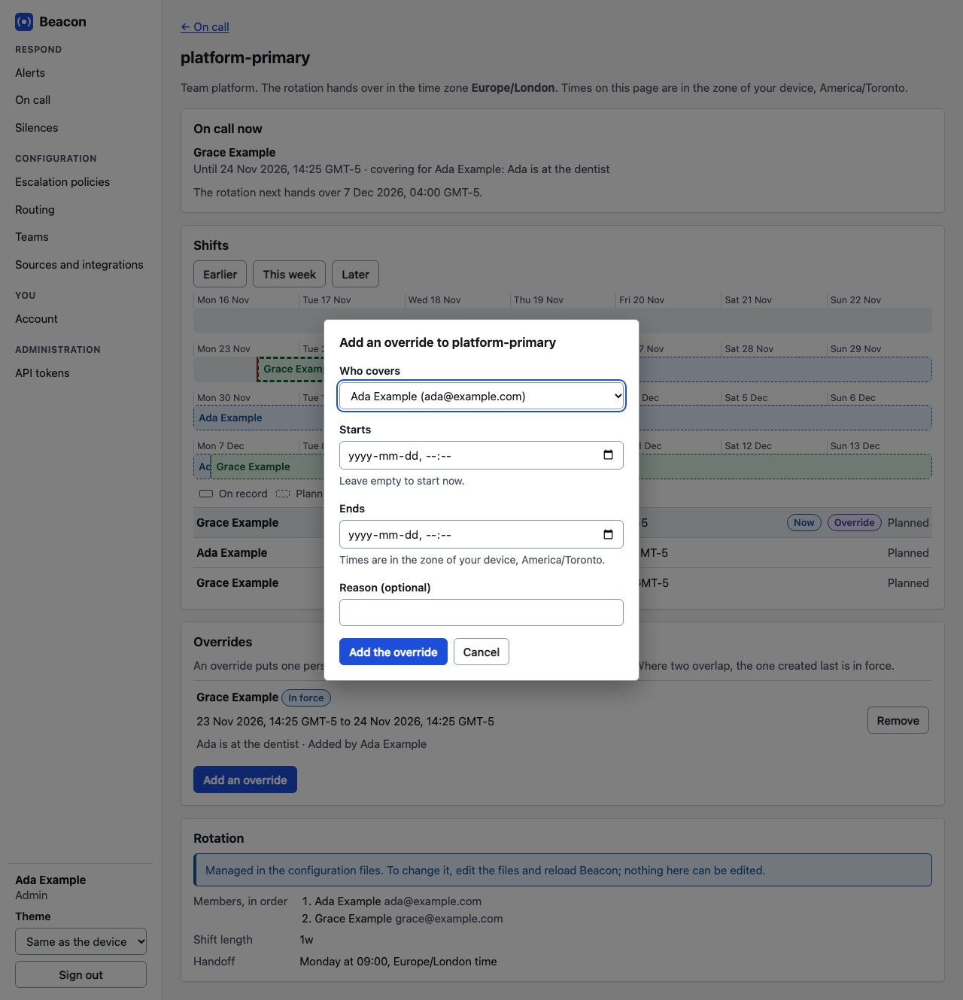

**Add an override** asks who covers, when it ends, and optionally when it starts (now, when left empty) and why. The times are typed in the zone of your device. Beacon checks the request, and what it refuses is said in the dialog, at the field at fault. **Remove** asks first, because it changes who is on call: an override in force ends at once, and whoever is beneath takes over, an earlier override or else the rotation.

Members and admins alike add and remove overrides, for themselves and for others. Who is on call, the calendar and the on-call page follow at once.

## Silences

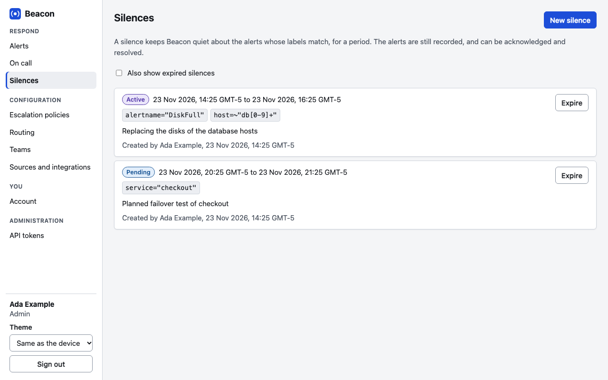

**Silences** lists the silences that are active or pending ([[silences]]), the one that ends first at the top: what each matches, from when to when, why, and who created it. **Also show expired silences** adds the ones that are over.

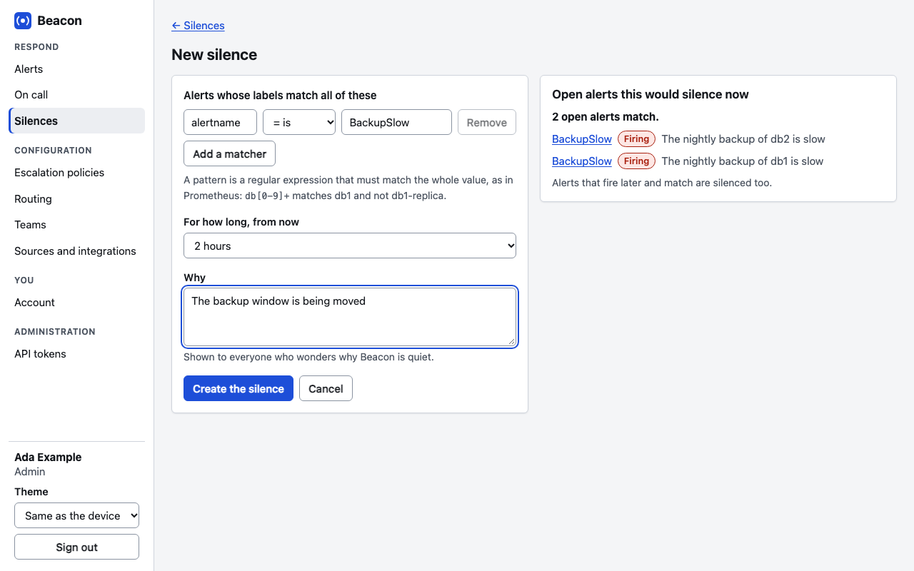

**New silence** asks for the matchers, for how long (or until a time you choose) and why. While you fill it in, the page shows **which open alerts the silence would keep quiet now**: it asks Beacon, which matches as it will when the silence exists, so the preview and the silence cannot disagree. A matcher that Beacon refuses, such as a pattern that is no regular expression, is said there with the part at fault. Alerts that fire later and match are silenced too.

**Expire** ends a silence now, after asking: Beacon then tells about the alerts it was keeping quiet that still fire. A silence cannot be edited; expire it and create another.

Members and admins alike create and expire silences, including ones that someone else created.

## What the configuration defines

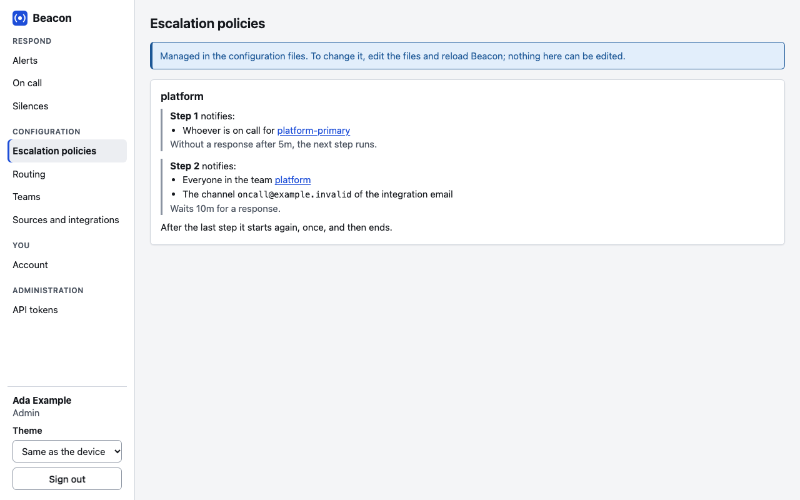

Under **Configuration** the app shows what is active now, which is what the files said at the last start or reload ([[configuration#Reload without a restart]]): the escalation policies ([[escalation]]), the routing rules in the order they are tried ([[configuration#How an alert is routed]]), the teams, and the sources and integrations. Names link to each other: a step to the schedule it pages, a rule to its team and policy, a team to its schedules. No credential is shown, because the API answers none ([[api#What the configuration defines]]).

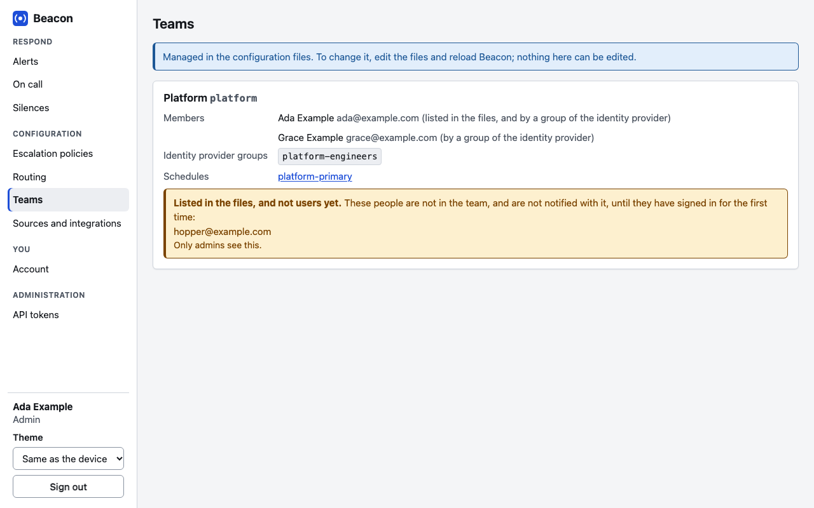

A team lists the people who belong to it now and why: listed in the files, in a group of the identity provider, or both ([[configuration#Team membership]]). **An admin also sees the addresses that the files list and that no user has**, because the person has not signed in yet: such a person is not in the team, and is not notified with it, until their first sign-in. Members do not see them; the API does not answer them to a member.

## Account and chat accounts


**Account** shows who you are signed in as and, under **Chat accounts**, which account in each Slack and Discord integration is yours ([[access#Chat accounts]]). Acknowledging and snoozing from chat need one, and so does being paged there.

- **Slack** accounts are found by Beacon, by your email address. There is nothing to do; the page says whether it has found yours.
- **Discord** accounts you link yourself. **Get a link code** shows the command to type in Discord ([[discord#People]]). The code works once, for ten minutes, and is shown only then. The page notices when the account is linked. **Remove the link** undoes it, after asking.

The bootstrap admin is not a person and gets no code; the page says what Beacon answers.

## API tokens

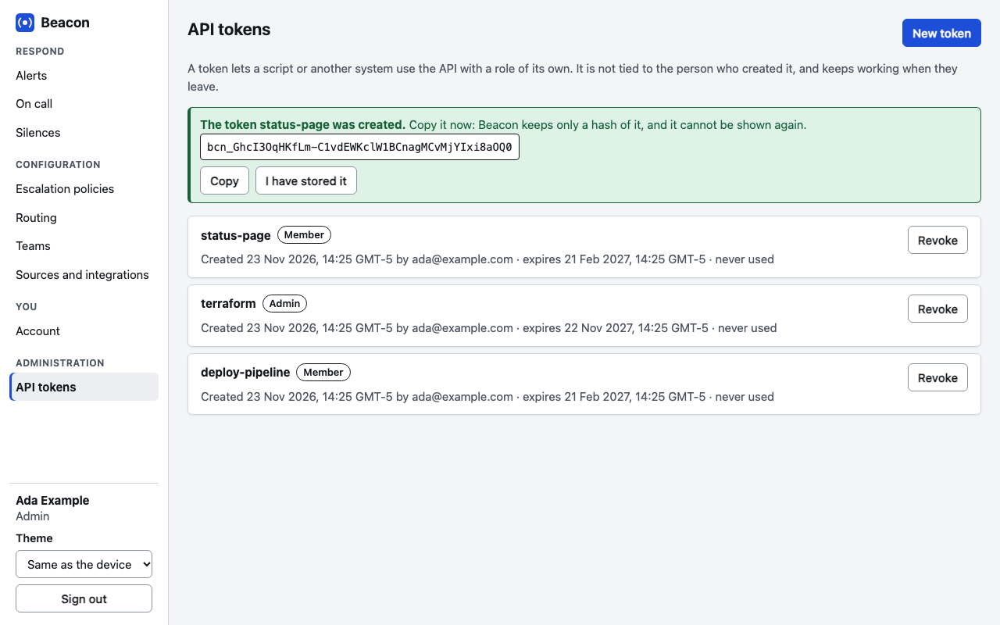

**API tokens**, under **Administration**, is for admins ([[access#API tokens]]): a token can carry any role. It lists the tokens with their role, who created them and when, when they expire and when they were last used, never their secrets. **New token** asks what it is for, its role and for how long it is valid, and then shows the secret **once**: Beacon keeps only a hash. The page keeps the secret in memory until you press **I have stored it** or leave. **Revoke** stops a token at once, after asking.

A member is not offered the page, is told that it is for admins when they open its address, and gets `403` from the API whatever the app shows.

## Look and use

- **Themes.** Light and dark. The app follows the device until you choose one under **Theme**; the choice is kept in the browser.
- **Small screens.** Every page works at the width of a phone; the navigation is behind **Menu** there.
- **Keyboard.** Everything can be reached and used with the keyboard. The first stop of the Tab key on every page skips the navigation.
- **Times** are shown in the time zone of your device, with the zone named.

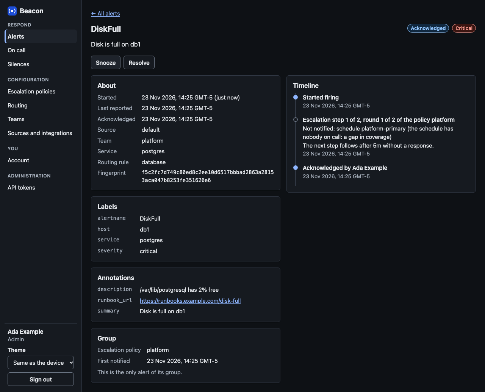

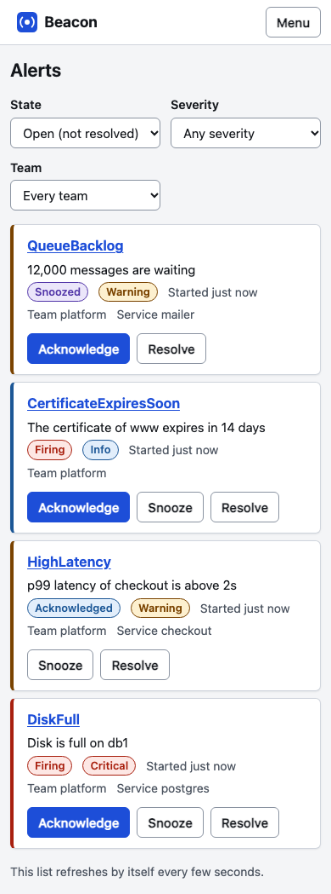

## What the browser is given

- **The app is public; what it shows is not.** The page, its script and its style sheet are served to anyone who asks, like the sign-in routes: they are the files of an open-source project and hold nothing of an install. Everything else comes from the API, which answers `401` without a session. An address under `/api/` or `/auth/` is never answered with the page, so a mistyped API address is still `401` and JSON.
- **The session is a cookie that scripts cannot read** (`HttpOnly`, `SameSite=Lax`, and `Secure` over https). The app keeps no token, and nothing that stands for the session, in the browser's storage. It keeps two things there: the theme you chose, and, for the length of a sign-in, the page you had asked for.
- **Requests that change something** pass the same cross-site check as every other request with a session ([[access]]): the browser says they come from Beacon's own pages.
- **A Content-Security-Policy** lets the page load scripts, styles, images and fonts from Beacon alone, with no inline script or style, talk to Beacon alone, and be shown in no frame. `X-Content-Type-Options: nosniff`, `X-Frame-Options: DENY` and `Referrer-Policy: no-referrer` are set as well.
- **Nothing is loaded from another host**: no fonts, no scripts, no analytics. A browser that can reach Beacon needs to reach nothing else.
- **Caching.** The script and the style sheet have a hash of their content in their name and are kept by the browser for good; the page itself is asked about again at every visit, so a new release is picked up at once.

If Beacon is behind a proxy that sets security headers of its own, let Beacon's through for the app, or set a policy at least as strict.

## For an install

Nothing to do. The release image has the app in it, and `beacon serve` serves it at every address that is not the API's. `auth.public_url` is the address people open.

A binary that was built from source without building the app first says so in its log at start (`this binary was built without the web interface`) and shows a short notice in place of the app. The API works either way.

## Development

The app is in `web/`: React and TypeScript, built by Vite. Node is pinned in `.tool-versions` with the other tools; npm comes with it.

```sh
cd web
npm ci
npm run build        # type check, then build into internal/web/dist
cd .. && go build -o bin/beacon ./cmd/beacon   # the binary now has the app in it
```

**Go alone needs no Node.** `go build ./...` and `go test ./...` work in a checkout where the app was never built: the binary then has no app, and the one test that needs it is skipped (and fails in CI, where the app is always built first).

To work on the app, run a Beacon and the development server, which serves the app with hot reload and passes `/api` and `/auth` on to that Beacon, so the browser sees one origin as in a release:

```sh
docker compose up -d --wait postgres dex mailpit
go build -o bin/beacon ./cmd/beacon
cd web
npm run dev:beacon   # a Beacon on 127.0.0.1:18080 with a database of its own and the Dex users
npm run dev          # in another terminal: the app on http://127.0.0.1:5173
```

Sign in as `ada@example.com` (an admin) or `grace@example.com` (a member), both with the password `password`; they are the users of the Dex in `compose.yaml`. `BEACON_URL` points the development server at another Beacon.

| Command, in `web/` | What it does |
|---|---|
| `npm run typecheck` | Type check |
| `npm run lint` | ESLint |
| `npm test` | Unit and component tests (Vitest, Testing Library) |
| `npm run generate` | Regenerate `src/api/schema.d.ts` from `internal/api/openapi.yaml` |
| `npm run generate:check` | Fail if those types are stale; CI runs it |
| `npm run e2e` | The browser tests (Playwright), against `bin/beacon`; build the app and the binary first |

**The API types are generated.** The app calls the API through a client that is typed from the OpenAPI description, so a route, a parameter or a field that the API does not have does not compile. After a change to `internal/api/openapi.yaml`, run `npm run generate` and commit the result.

**The browser tests** start the real binary against a database of their own, sign in through Dex, and use the app as a person would. Each main view is also checked with [axe](https://github.com/dequelabs/axe-core) for accessibility, in both themes and at the width of a phone. `npx playwright install chromium` fetches the browser once.
